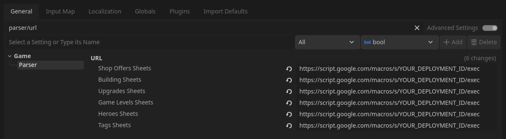
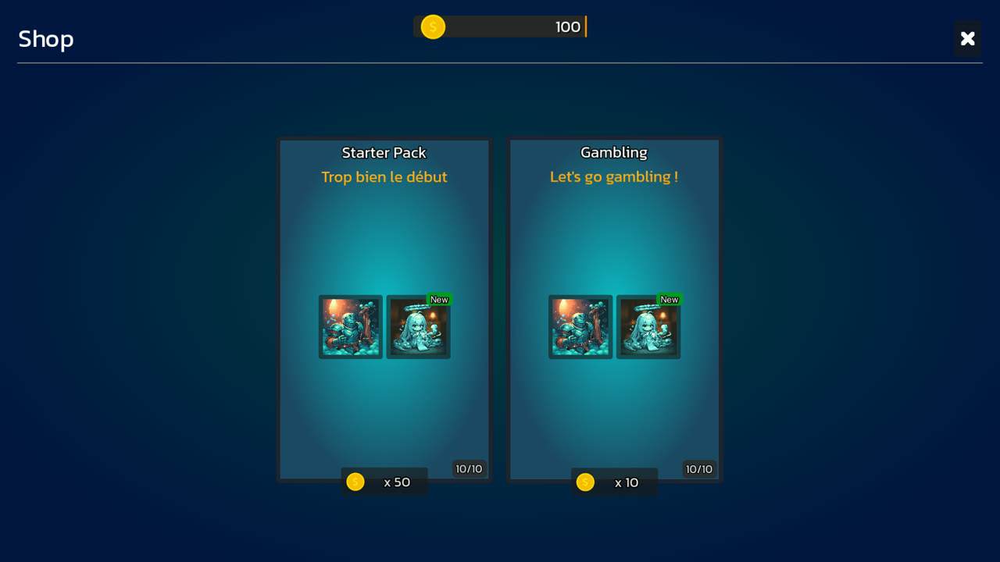

## Data Pipeline

The main goal of the project is to let designers balance the game without touching Godot.

- Wrote a Google Apps Script that exports every sheet of the spreadsheet to JSON. Designers mark their tables with `[Table Start]`, `[Table End]` and `[Ignore]` tags.
- Made a data parser panel inside the Godot editor that downloads the JSON and generates the game resources: heroes, abilities, campaigns, levels, rewards, upgrades, buildings, shop offers and lootboxes.
- Added a build button, error logs and checks for missing references, so a mistake in the spreadsheet is easy to find.
- Made editor tools to fill data arrays, and an editor profile that simplifies the Godot editor for students.

### How to use it

1. Publish the Apps Script as a web app, then paste its URL in the Project Settings (one URL per type of data).



2. In the Parser panel, click **Build Game** to pull everything at once, or pick one type of data and click **Parse Data**.
3. The parser creates or updates the resources in the `parsed_data` folder, ready to be used by the game.

```grid
images/parser_panel.jpg | Parser panel
images/parser_output.jpg | Generated resources
```

## Combat

- Implemented an automatic combat system: a combat server, an attack queue and a damage/heal formula based on ability power.
- Made an ability targeting system (AoE, closest, weakest/strongest, tagged heroes).
- Made the combat field, the team builder, the hero details panel and a pause menu.
- Added a combat log and a speed debugger to test fights faster.
- Added feedbacks: damage/heal numbers, flash, squish animation and death sprites.

```grid
images/team_builder.jpg | Team builder
images/hero_inventory.jpg | Hero inventory
```

## Progression

- Campaigns and levels with selection, unlocking, progression and rewards.
- Buildings with upgrades, costs and build times.
- Unlock conditions that give their rewards only once.
- Lootboxes and currencies in the shop.

```grid
images/campaigns.jpg | Campaign selection
images/levels.jpg | Level selection
```



## Save System and UI

- Made a dynamic save system that saves the inventory, the progression and the building timers, with a "Delete save" button for debugging.
- Added the settings panel, and the victory/defeat panels with reward animations and sound effects.

## Games Made With It

The second-year Game Design students at Isart Digital used the project as a base for their own games. They designed their own heroes, resources, buildings and campaigns in the spreadsheets, and replaced the art, without changing the code.

### Les Aventures de Fercule

```grid
images/fercule_campaigns.jpg | Campaigns
images/fercule_team_builder.jpg | Team builder
images/fercule_hero_details.jpg | Hero details and level up cost
images/fercule_fight.jpg | Fight
```

### Team Goobers

```grid
images/goobers_buildings.jpg | Buildings
images/goobers_team_builder.jpg | Team builder
images/goobers_levels.jpg | Levels
images/goobers_fight.jpg | Fight
```
