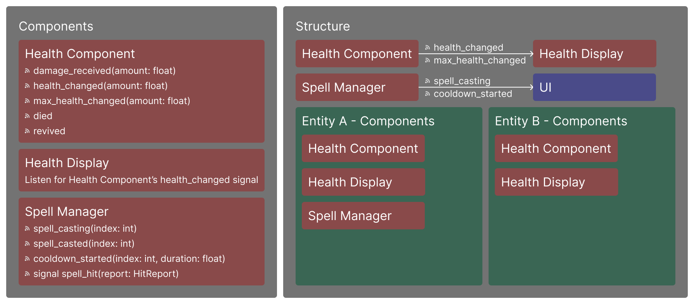
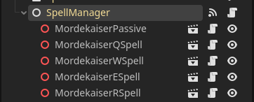
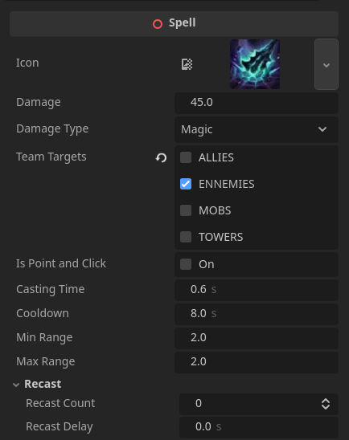

I only recreated the characters, spells and items system for this project.


## Composition over Inheritance

Composition is great for making modular games. The idea is to create small, reusable components.

In Godot, composition works by making scripts inherit from nodes such as `Area3D` (Trigger) or `Control` (UI), and communicating through signals. This workflow is effective because it avoids hard-coded references.

For example, I created multiple components for entities, such as:

- **Health Component** – Manages health and life state. Key events like death or health changes are communicated via signals.
- **Health Display** – A 3D progress bar that visually displays the health of a Health Component.
- **Spell Manager** – A script that handles spell casting and cooldowns.



## Spells

I'm using Godot nodes for the spell system. This allows me to manage spell data easily and assign spells to different characters.

Each spell is a node that can be added to the Spell Manager, which manages cooldowns and casting.




All spell data is exposed in the editor, so I can easily tweak values like damage and target types.



## Items

I implemented an item system inspired by *League of Legends*. Items can be purchased in the shop. The example below shows an item that gradually increases movement and attack speed over time.


Here's the code for the item (in C#):

```csharp
using Godot;

public partial class DoranSword : Accessory
{
    private float _speedBonus = 0;

    public override void OnHit(Entity entity, Entity damager)
    {
        entity.HealEntity(100);
    }

    public override void Tick(Entity entity, float delta)
    {
        _speedBonus += delta;
        entity.BonusMoveSpeed += _speedBonus;
        entity.BonusAttackSpeed += _speedBonus;
    }
}
```

## Networking

The game uses a dedicated server architecture. Each player is a client; the server has authority over the game world, while the clients have authority over player inputs.

Using a dedicated server helps prevent cheating and makes it easy to deploy on cloud platforms.

I'm using Godot's multiplayer system. Inputs are sent using RPCs (Remote Procedure Calls).

Items, spells, and inputs are automatically synced with the server. I only need to manually sync special interactions like Mordekaiser’s ultimate.


## What Did I Learn?

This project was a wonderful experience — but not without its challenges! Here are a few things I would do differently:

- **Use a state machine** – It would have made character state management much cleaner.
- **Spend less time on visuals** – I spent too much time on character models and animations, which weren’t essential for a prototype.
- **Networking is hard!** – I got it working, but network traffic is heavy, up to 60KiB/s at peak. That doesn't sound like a lot but I only had 2 characters inside my scene and no game logic was implemented.
- **And finally...** If you made it this far, it means you were interested enough to read the entire page — and for that, thank you!
