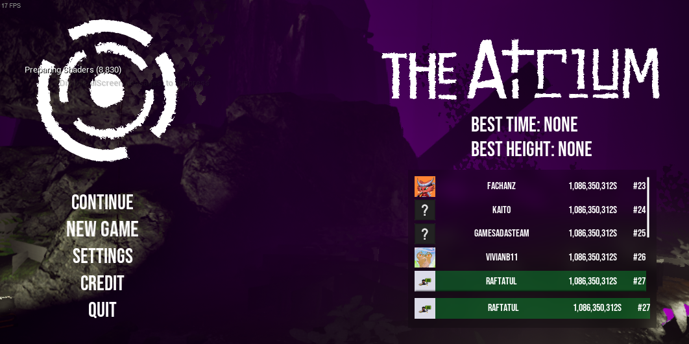

## Camera

The camera was designed to feel alive and dynamic without giving the sensation of motion sickness.

Here is a list of elements implemented:

### Camera Tilt

The camera tilts a little based on the x velocity relative to the camera of the player.


### Camera Bobbing

Apply camera bobbing when the player is moving on the ground using the Camera Shake system of Unreal Engine. The shake force depends on the movement state of the player (walk/run).


### FOV

Since the player constantly needs to focus on a surface, the field of view is kept wide to allow them to see more around the edges of the screen. The FOV expands further when the player falls, enhancing the feeling of speed.


## Character

To navigate through the level, the player can walk/run and use his bump ability.

**Bump Ability**

- The player can push himself in the opposite direction he is facing when bumping on certain surfaces.
- There is a max amount of 3 charges, the charges reload when the player touches the ground.


## UI

Bump ability feedback:

- The player is notified he can bump when the white dot appears.
- An animation is played when the player uses the bump input.
- When a bump is successfully made, a charge is removed (turning a charge gray).


## Steam Integration

I implemented Steam using the [Steam SDK](https://partner.steamgames.com/doc/sdk) and Unreal C++ to be able to use the leaderboard system of Steam.



## Dynamic Fog

A fog that can alternate between multiple colors so its color changes according to the player's height position.

Here is what I made to accomplish this effect:

- First, I create an array of structures containing a color variable and a height variable.
- Next, I need to find the 2 colors closest to the camera's height position.
- Then, I blend the colors based on the camera's position between the two color positions.
- Finally, I apply the color in a post-process material.

```grid
images/Fog.png | Fog blueprint
videos/fog.mp4 | Dynamic fog
```

## Save System - Settings

I worked on the save system, it registers the player's position, time and settings.

I implemented the graphics, audio and gameplay settings. Each parameter is saved by the Unreal Save System.
