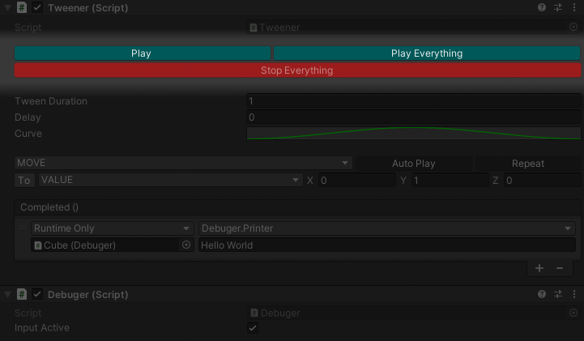
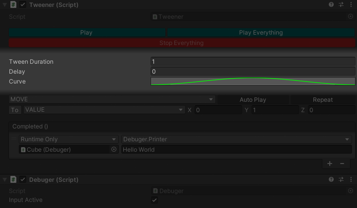
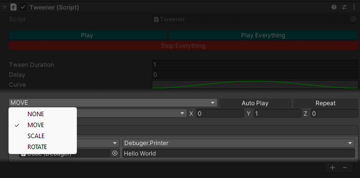
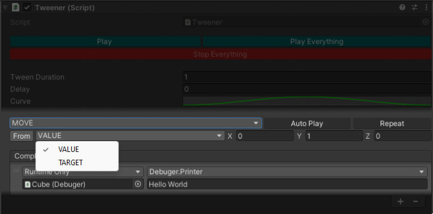
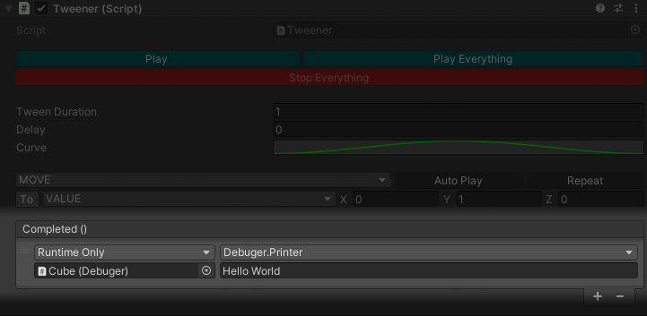

<div style="position: fixed; perspective: 100px; width: 50px; z-index: 5; display: none;" id="move">
    
</div>

## Video Demo

Here is a little demo to show you how to make an animation using the tween component.


## Overview

The Tween component is an easy-to-use script that allows me to animate the position/rotation/scale of a 3D object or UI element.

I just need to add the component to the object and then change the parameters.

### Functions

- **Play:** This button calls the Play function.
- **Play Everything:** This button calls the Play function for every tween component on the object.
- **Stop Everything:** This button calls the Stop function for every tween component on the object.



### Parameters

- **Tween Duration:** This parameter represents the duration of the tween.
- **Delay:** This parameter represents the delay before the tween is played.
- **Curve:** This parameter represents how the value will change over time.



### Tween Types

This is used to set which variable will be impacted in the object's transform.

- **None:** Do nothing.
- **Move:** Change the object's relative position.
- **Scale:** Change the object's relative scale.
- **Rotate:** Change the object's relative rotation.



### Auto Play & Loop

I can toggle whether the tween should start automatically and set it to play indefinitely.


### Initial Variables

This parameter is used to set the initial variables from which the tween will start.

- **To:** The object will start the tween from the object's values (based on the tween type) then tween to the tween values (X,Y,Z).
- **From:** The object will start the tween from the tween values (X,Y,Z) then tween to its values before the tween started (based on the tween type).

```grid
images/tween_value.png | To
images/tween_from.png | From
```

### Tween Target Mode

This parameter allows me to switch between 2 targeting modes.

- **Value:** Use the Vector3.
- **Target:** Use the object's target variables (based on the tween type).



```grid
images/tween_value.png | Value
images/tween_target.png | Target
```

### Callback

- **Completed:** This event is invoked at the end of the tween.


