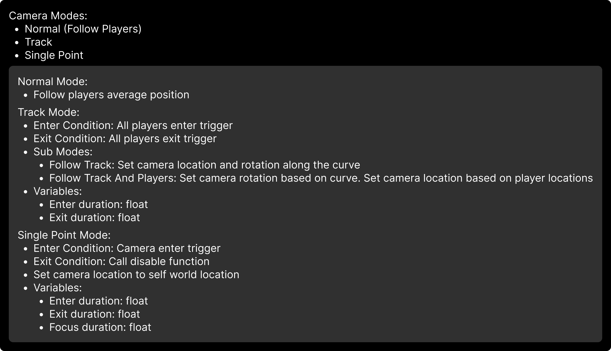

## My Contributions

- Participated in the design of the 3Cs (movement, camera, combat control) for both player states (fused and separated)
- Implemented the characters in blueprints
- Developed dynamic camera systems (top-down & 2.5D) with adaptive framing
- Implemented editor tools for level design

## Controls

The controls are designed to be intuitive and easy to use. The mouse uses the left stick to move and to aim. The robot uses the left stick to move and the right stick to aim.

They can dash to avoid taking damage from enemies and the environment

But that not all, each characters has their own unique way to play.

## Characters

### The Mouse

The mouse is a brawler style combat.

He can unleash powerful close-range attacks.

#### Synergy:

The mouse can pull the robot. The robot deal damage during this state.

#### Air Attack

When launched, the mouse can perform a special attack that damages all enemies beneath him.

If it hits successfully, the mouse is launched back into the air and can perform the special attack again.

### The Robot

The mouse is a ranger combat style.

It can unleash powerful long-range attacks.

#### Synergy:

The robot can launch the mouse when they are close to each other. This action can be used to solve puzzles or in combat ().

## Camera

### Primary Components

- **Trigger box** to apply data to the camera
- **Rail** to force the camera following a specific path using a spline
- **Single point trigger** to snap the camera on a point, used in combat phases

### Behaviors

The camera follows the 2 players, and they cannot leave the screen.

The camera has 3 main modes:

### Camera Angles

The angle of the camera dynamically change during the game

#### Side Scrolling

This camera is used during exploration/puzzle phases.

#### Top Down

This camera is used during combat phases.

### Camera Rail

An actor that forces the camera to follow a rail — perfect for cinematic transitions.

### Camera Focus Point

An actor that forces the camera to move to a specific point.

